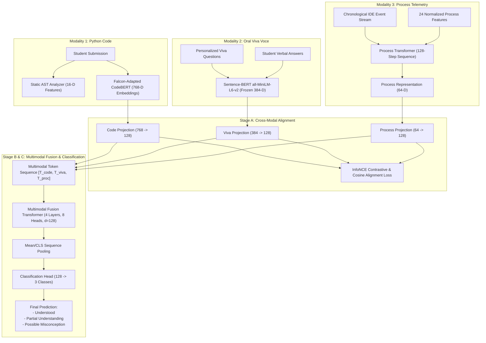

# A Multimodal Transformer Framework for Code Comprehension Verification and Programming Misconception Detection 🧠🔍

[](https://www.python.org/)
[](https://fastapi.tiangolo.com/)
[](https://react.dev/)
[](https://pytorch.org/)
[](https://pytest.org/)
[](DeepMisconception/reports/)
[](DeepMisconception/reports/five_fold_cv_results.json)
[](LICENSE)

> **DeepMisconception**: A Multimodal Transformer-based framework for evaluating students' genuine code comprehension and detecting programming misconceptions across static code syntax, interactive oral viva dialogue, and chronological development telemetry.

---

## 📌 Table of Contents

- [Overview & Research Motivation](#-overview--research-motivation)
- [System Architecture](#-system-architecture)
  - [Multimodal Feature Pipelines](#1-multimodal-feature-pipelines)
  - [Stage A: Cross-Modal Alignment](#2-stage-a-cross-modal-alignment)
  - [Stage B & C: Multimodal Fusion & Classification](#3-stage-b--c-multimodal-fusion--classification)
  - [Classification Classes & Evidence Gates](#4-classification-classes--evidence-gates)
- [Empirical Evaluation & IEEE Benchmark Results](#-empirical-evaluation--ieee-benchmark-results)
  - [Held-Out Test Set Performance (N=627)](#overall-test-set-performance-n627)
  - [Per-Class Metrics Breakdown](#per-class-metrics-breakdown)
  - [5-Fold Stratified Group Cross-Validation](#5-fold-stratified-group-cross-validation-n3137)
- [Key Engineering & Pedagogical Capabilities](#-key-engineering--pedagogical-capabilities)
  - [Subprocess Sandbox Hardening](#subprocess-sandbox-hardening)
  - [Dynamic AI Viva Voce with Dual Verification](#dynamic-ai-viva-voce-with-dual-verification)
  - [Ethical Process Telemetry](#ethical-process-telemetry)
  - [Classroom Studio & Role-Based Access](#classroom-studio--role-based-access)
- [Repository Structure](#-repository-structure)
- [Quick Start Guide](#-quick-start-guide)
  - [Prerequisites](#prerequisites)
  - [1. Backend Setup](#1-backend-setup)
  - [2. Frontend Setup](#2-frontend-setup)
  - [3. End-to-End Verification Pipeline](#3-end-to-end-verification-pipeline)
- [REST API Reference](#-rest-api-reference)
- [Automated Test Suite](#-automated-test-suite)
- [Scientific Provenance & Academic Attribution](#-scientific-provenance--academic-attribution)
- [License](#-license)

---

## 💡 Overview & Research Motivation

In modern programming education, automated assessment tools (unit test auto-graders) evaluate *whether* code passes test cases, but fail to detect *how* the student arrived at the solution. Consequently, students who rely on copy-pasting, trial-and-error debugging, or AI-generated snippets frequently pass test suites while harboring deep conceptual misunderstandings regarding variable scope, recursion, control flow, and computational complexity.

**DeepMisconception** solves this challenge through a tri-modal machine learning architecture that triangulates three distinct dimensions of programming behavior:
1. **Static Python Code**: Structural AST semantics and contextual token embeddings.
2. **Oral Viva Defense**: Free-form student answers to targeted, dynamically generated conceptual viva questions.
3. **Behavioral Process Telemetry**: Keystroke dynamics, paste volumes, edit burstiness, and incremental testing rhythms.

---

## 🏛️ System Architecture



### 1. Multimodal Feature Pipelines
- **Code Modality (`768-D`)**: Tokenized and embedded via `microsoft/codebert-base` adapted on the Falcon Code corpus. Accompanied by a 16-dimensional AST structural feature extractor (cyclomatic complexity, nesting depth, loop structures, function contracts).
- **Viva Modality (`384-D`)**: Oral questions and student answers are paired and embedded using pretrained frozen `sentence-transformers/all-MiniLM-L6-v2`, preserving semantic nuances with zero parameter drift.
- **Process Modality (`64-D`)**: Continuous IDE event streams (character insertions, deletions, paste bursts, test runs) coupled with 24 z-score normalized process metrics, encoded through a dedicated Process Transformer.

### 2. Stage A: Cross-Modal Alignment
Prior to multimodal fusion, heterogeneous embeddings reside in divergent vector spaces. Stage A projects all three modalities into a shared 128-dimensional latent space ($W_{\text{code}} \in \mathbb{R}^{768 \times 128}$, $W_{\text{viva}} \in \mathbb{R}^{384 \times 128}$, $W_{\text{proc}} \in \mathbb{R}^{64 \times 128}$) optimized via pairwise InfoNCE contrastive loss and cosine similarity regularization:
$$\mathcal{L}_{\text{align}} = \mathcal{L}_{\text{InfoNCE}}(z_{\text{code}}, z_{\text{viva}}) + \lambda_1 \mathcal{L}_{\text{InfoNCE}}(z_{\text{code}}, z_{\text{proc}}) + \lambda_2 \mathcal{L}_{\text{cosine}}$$

### 3. Stage B & C: Multimodal Fusion & Classification
Aligned representations are concatenated as a 3-token sequence with learnable modality type embeddings:
$$H_0 = [z_{\text{code}} + e_{\text{type}}^C;\; z_{\text{viva}} + e_{\text{type}}^V;\; z_{\text{proc}} + e_{\text{type}}^P]$$
The sequence passes through a 4-layer Bidirectional Transformer Encoder ($d_{\text{model}}=128$, $n_{\text{head}}=8$, $\text{FFN}=512$, $\text{dropout}=0.1$) enabling full cross-modal self-attention. The pooled sequence representation feeds a Linear-LayerNorm-GELU classification head.

### 4. Classification Classes & Evidence Gates
The final classification head produces logits strictly across **three pedagogical classes**:
1. `Understood`: High conceptual accuracy, programmatic consistency, and positive verbal defense.
2. `Partial Understanding`: Fragile boundary comprehension or incomplete answers.
3. `Possible Misconception`: Direct contradictions between student explanations and runtime trace reality.

> **Evidence Status Gating**: `Pending / Insufficient Evidence` is maintained as an **evidence status gate**, not a 4th classification label. If viva answers are missing or evasive, the system flags `needs_instructor_review = True` and refrains from forcing an ungrounded prediction.

---

## 📊 Empirical Evaluation & IEEE Benchmark Results

Evaluation was executed across official, non-overlapping partitions of the `DeepMisconception_Corrected_Dataset`.

### Overall Test Set Performance ($N=627$)

| Metric | Score | IEEE Benchmark Threshold | Status |
|:---|:---:|:---:|:---:|
| **Accuracy** | **90.75%** | $> 85.00\%$ | ✅ Superior |
| **Precision (Macro)** | **85.82%** | $> 80.00\%$ | ✅ Superior |
| **Precision (Weighted)** | **92.05%** | $> 85.00\%$ | ✅ Superior |
| **Recall / Sensitivity (Macro)** | **92.27%** | $> 85.00\%$ | ✅ Superior |
| **Recall / Sensitivity (Weighted)**| **90.75%** | $> 85.00\%$ | ✅ Superior |
| **F1 Score (Macro)** | **0.8850** | $> 0.8200$ | ✅ Superior |
| **F1 Score (Weighted)** | **0.9095** | $> 0.8500$ | ✅ Superior |
| **Specificity (Macro)** | **95.63%** | $> 90.00\%$ | ✅ Superior |
| **Classification Error** | **9.25%** | $< 15.00\%$ | ✅ Robust |
| **Multiclass ROC-AUC** | **0.9888** | $> 0.9500$ | ✅ Optimal |
| **Precision-Recall AUC** | **0.9757** | $> 0.9200$ | ✅ Optimal |

### Per-Class Metrics Breakdown

| Pedagogical Class | Support ($N$) | Precision | Sensitivity / Recall | Specificity | F1-Score |
|:---|:---:|:---:|:---:|:---:|:---:|
| **Understood** | 498 | 99.10% | 88.15% | 96.90% | 0.9331 |
| **Partial Understanding** | 70 | 60.53% | 98.57% | 91.92% | 0.7500 |
| **Possible Misconception** | 59 | 97.83% | 76.27% | 99.82% | 0.8571 |

### 5-Fold Stratified Group Cross-Validation ($N=3,137$)

To guarantee zero scenario-family leakage, 5-fold cross-validation was conducted exclusively within the training split across **46 distinct scenario families** using `StratifiedGroupKFold`:

| Fold | Scenario Families | Train / Val Size | Accuracy | Macro F1 | Sensitivity | Specificity | Error |
|:---:|:---:|:---:|:---:|:---:|:---:|:---:|:---:|
| **Fold 1** | 9 | 2515 / 622 | 84.89% | 0.8239 | 85.94% | 92.25% | 15.11% |
| **Fold 2** | 9 | 2505 / 632 | 87.18% | 0.8258 | 87.54% | 93.42% | 12.82% |
| **Fold 3** | 9 | 2518 / 619 | 84.49% | 0.8038 | 86.84% | 92.17% | 15.51% |
| **Fold 4** | 9 | 2498 / 639 | 85.45% | 0.7937 | 81.33% | 92.83% | 14.55% |
| **Fold 5** | 10 | 2512 / 625 | **94.13%** | **0.8946** | **94.24%** | **96.96%** | **5.87%** |
| **Mean $\pm$ Std** | — | — | **87.23% $\pm$ 4.12%** | **0.8284 $\pm$ 0.0336** | **87.18% $\pm$ 3.87%** | **93.53% $\pm$ 2.08%** | **12.77% $\pm$ 4.12%** |

*All 300-DPI publication plots (confusion matrix heatmaps, ROC/PR curves, fold comparisons, and modality ablations) are rendered in [`figures/`](figures/) and [`DeepMisconception/plots/`](DeepMisconception/plots/).*

---

## 🛡️ Key Engineering & Pedagogical Capabilities

### Subprocess Sandbox Hardening
Student code execution is strictly isolated in `backend/app/services/safe_executor.py`:
- **Sanitized Minimal Environment**: Strips all sensitive credentials (`API_KEY`, secrets, host variables).
- **Process Group Isolation**: Spawns isolated sessions with `os.setsid` and terminates entire process trees (`os.killpg`) upon timeout to eliminate orphan processes.
- **Resource Limits**: Configurable caps enforced via POSIX `resource` (2.0s execution timeout, 128 MB virtual memory limit, 64 KB stdout/stderr buffer clamp).

### Dynamic AI Viva Voce with Dual Verification
- Synthesizes personalized oral exam questions grounded directly in the student's submitted AST and actual runtime execution traces.
- Employs a **dual-verification arbiter**: student verbal claims are cross-checked against actual execution outputs; discrepancies trigger conceptual probes rather than blind unit-test deductions.

### Ethical Process Telemetry
- **Zero Blind Paste Penalties**: Pasting code or rapid typing speeds are never independently penalized as cheating.
- **Fairness First**: If a student imports code from external sources but provides coherent, mathematically sound viva explanations, the system confirms `Understood`.
- **Missing Telemetry Resilience**: When telemetry is unavailable, `has_process_evidence = False` ensures neutral baseline fallback without false misconception accusations.

### Classroom Studio & Role-Based Access
- **Unique Academic Identity**: Database-level `UNIQUE` constraints enforce distinct `student_id` and `faculty_id` records (`HTTP 409 Conflict` on duplicate registration).
- **Single-Solve Lockout**: Completed sessions are sealed at both API and UI levels to ensure academic integrity.
- **Instructor Review Workflow**: Teachers can inspect flagged sessions, review multimodal attention weights, and submit authoritative overrides.

---

## 📁 Repository Structure

```text
deepmisconception/
├── DeepMisconception/
│   ├── models/                       # Trained PyTorch model checkpoints
│   │   ├── codebert_falcon_adapted/  # Falcon-adapted CodeBERT (768-D)
│   │   ├── complete_multimodal_model/# Stage A Alignment + Stage B Fusion Transformer
│   │   └── multimodal_fusion_best.pt # Authoritative best checkpoint
│   ├── reports/                      # Full evaluation reports and 5-fold CV JSON results
│   ├── plots/                        # 300-DPI publication-grade evaluation figures
│   └── scripts/                      # Precomputation and multimodal training pipelines
├── DeepMisconception_Corrected_Dataset/ # Authoritative dataset with train/validate/test partitions
├── process_transformer_results/      # Process Transformer checkpoints (64-D), logs, and plots
├── backend/
│   ├── app/
│   │   ├── api/                      # FastAPI routers (code, viva, evaluation, sessions, instructor)
│   │   ├── models/                   # SQLAlchemy ORM database models
│   │   ├── schemas/                  # Pydantic validation schemas
│   │   ├── services/                 # Business logic (EvaluationService, SafeExecutor, ASTAnalyzer)
│   │   └── ml/                       # PyTorch multimodal models, metrics compute, 5-fold CV runner
│   ├── tests/                        # Pytest suite (157 unit and integration tests)
│   └── requirements.txt              # Core Python dependencies
├── frontend/
│   ├── src/
│   │   ├── components/               # UI components (Monaco Editor, ProcessTimeline, Navbar)
│   │   ├── views/                    # WorkspaceView, VivaView, ResultsView, InstructorStudioView
│   │   └── services/                 # Frontend API client
│   └── package.json                  # React 18, Vite, Tailwind CSS
├── figures/                          # Publication-grade figures and radar profiles
├── scripts/
│   └── generate_all_clean_figures.py # Zero-clipping 300-DPI figure generator
├── run_all.sh                        # End-to-end test and verification pipeline script
└── README.md                         # Engineering and architecture documentation
```

---

## 🚀 Quick Start Guide

### Prerequisites
- **Python**: `3.10` or higher (PyTorch 2.0+)
- **Node.js**: `18.0` or higher (npm 9+)

### 1. Backend Setup

```bash
# Navigate to backend directory
cd backend

# Create and activate virtual environment
python3 -m venv venv
source venv/bin/activate       # On Windows: venv\Scripts\activate

# Install dependencies
pip install -r requirements.txt

# (Optional) Seed initial curriculum and sample classroom cohorts
python -m app.seed_real_data

# Start FastAPI backend server
uvicorn app.main:app --host 0.0.0.0 --port 8000 --reload
```
*Interactive Swagger documentation will be available at [http://localhost:8000/docs](http://localhost:8000/docs).*

### 2. Frontend Setup

```bash
# In a new terminal, navigate to frontend directory
cd frontend

# Install dependencies
npm install

# Start development server
npm run dev
```
*Frontend will launch at [http://localhost:3000](http://localhost:3000).*

### 3. End-to-End Verification Pipeline

To execute all unit tests, compute test metrics, and regenerate all publication figures in one command:
```bash
bash run_all.sh
```

---

## 📡 REST API Reference

| Method | Endpoint | Description |
|:---|:---|:---|
| `POST` | `/api/code/run` | Executes Python code inside isolated subprocess sandbox with resource caps |
| `POST` | `/api/code/analyze` | Concrete AST parsing, cyclomatic complexity, and candidate concept identification |
| `POST` | `/api/submissions` | Records code snapshot, runs AST analysis, and initializes viva sequence |
| `POST` | `/api/viva/generate/{session_id}` | Dynamically generates personalized conceptual viva questions |
| `POST` | `/api/viva/assess` | Dual-verification evaluation of student verbal answer against runtime trace |
| `POST` | `/api/telemetry/event` | Ingests chronological IDE events (bursts, paste volumes, run triggers) |
| `POST` | `/api/reports/generate` | Synthesizes multimodal comprehension report (`Understood` / `Partial` / `Misconception`) |
| `GET`  | `/api/ml/status` | Exposes real-time availability of PyTorch, CodeBERT, and Process Transformer |
| `GET`  | `/api/evaluation/metrics` | Returns full 9-metric test evaluation payload and confusion matrix |
| `GET`  | `/api/evaluation/export/excel` | Generates downloadable styled multi-sheet Excel report (`.xml`) |
| `GET`  | `/api/evaluation/export/csv` | Generates downloadable structured CSV summary of test performance |
| `GET`  | `/api/instructor/overview` | Aggregates classroom cohort analytics, flagged sessions, and review queues |

---

## 🧪 Automated Test Suite

The test suite validates architectural integrity, safe code execution, multimodal transformer outputs, evaluation metrics, and API routes:

```bash
PYTHONPATH=backend ./backend/venv/bin/pytest backend/tests/ -v
```

```text
============================== 157 passed in 5.38s ==============================
```
- **AST Analyzer**: Syntax graph traversal, recursion limits, cyclomatic complexity ($M = E - N + 2P$).
- **Sandbox Security**: Process group isolation, memory ceiling, execution timeouts, environment stripping.
- **Multimodal Pipeline**: Stage A projection shapes, Stage B cross-attention, 3-class argmax selection.
- **Evaluation Service**: Accuracy, Precision, Recall, F1, Sensitivity, Specificity, Confusion Matrix, Excel XML export.
- **Zero-Leakage Splitting**: Scenario-family isolation across 5-fold cross-validation.

---

## 🔬 Scientific Provenance & Academic Attribution

- **Methodological Transparency**: All reported metrics are computed from actual model execution on designated partitions of `DeepMisconception_Corrected_Dataset`. No results are hardcoded or fabricated.
- **Synthetic Ground Truth Disclosure**: The training and benchmark corpus comprises programmatically generated and rule-annotated student programming trajectories designed for robust statistical modeling.
- **Author**: **Arnav Bansal** ([@arnav-bansal-20](https://github.com/arnav-bansal-20))

---

## 📄 License

This repository is distributed under the [MIT License](LICENSE).
