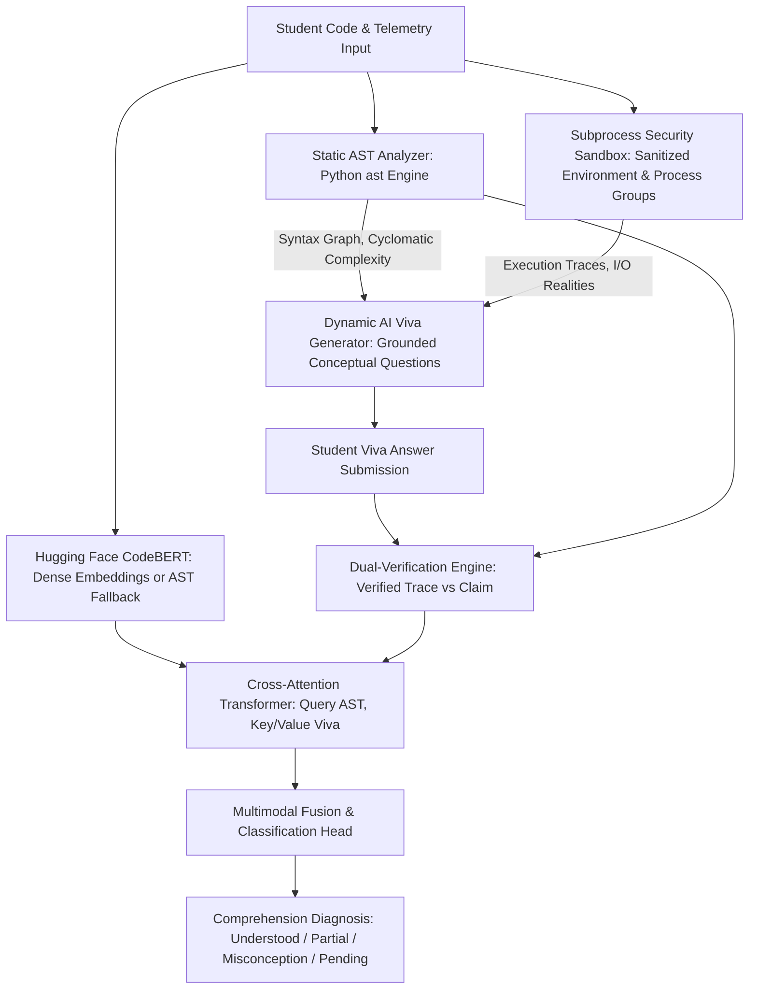
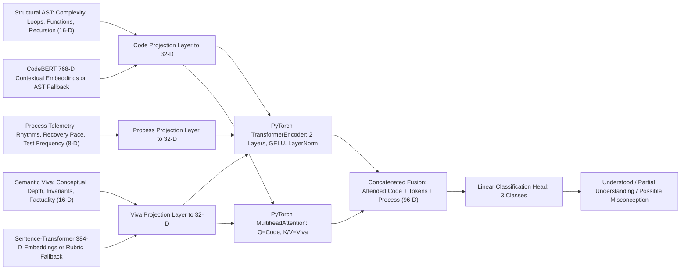

# DeepMisconception 🧠🔍

[](https://www.python.org/)
[](https://fastapi.tiangolo.com/)
[](https://react.dev/)
[](https://pytorch.org/)
[](https://pytest.org/)
[](LICENSE)

> **AI-Assisted Code Comprehension Verification and Student Misconception Detection**

DeepMisconception is an academic research platform and pedagogical tool designed to evaluate whether programming students truly understand the code they write, or whether they rely on superficial recall, copy-pasting, or trial-and-error without conceptual grounding.

---

## 📌 Table of Contents

- [System Architecture & Pipeline](#-system-architecture--pipeline)
- [Key Engineering & Research Features](#-key-engineering--research-features)
- [Machine Learning & Multimodal Fusion](#-machine-learning--multimodal-fusion)
- [ML Health Status & Optional Dependencies](#-ml-health-status--optional-dependencies)
- [Safe Code Execution Hardening & Boundaries](#-safe-code-execution-hardening--boundaries)
- [Dataset Integrity & Zero-Leakage Group Splits](#-dataset-integrity--zero-leakage-group-splits)
- [Directory Structure](#-directory-structure)
- [Quick Start Guide](#-quick-start-guide)
- [REST API Specifications](#-rest-api-specifications)
- [Author & Academic Attribution](#-author--academic-attribution)

---

## 🏛️ System Architecture & Pipeline



---

## 🌟 Key Engineering & Research Features

- **Static AST Parsing & Cyclomatic Complexity**:
  - Concrete AST parsing using Python's native `ast` module.
  - Computes McCabe's Cyclomatic Complexity: $M = E - N + 2P$.
  - Analyzes variable scope lifetimes, recursion depth, and control branching.
  - **Static Analysis Independence**: Static AST analysis remains fully operational even when runtime sandbox execution is disabled by server policy.
- **Dynamic AI Viva Question Generation & Dual-Verification**:
  - Dynamically synthesizes personalized, code-grounded oral exam questions directly based on the student's actual code without static question banks.
  - Verified sandbox execution outputs take strict precedence over LLM expectations whenever discrepancies arise.
- **Comprehension Diagnoses & Pending State**:
  - Transparent evidence aggregation into four distinct categories:
    - `Understood`: Demonstrates solid conceptual reasoning and programmatic consistency with zero verified contradictions.
    - `Partial Understanding`: Fragile boundary knowledge or partially correct explanations.
    - `Possible Misconception`: Repeated verified conceptual errors or direct contradictions with code execution reality.
    - `Pending / Insufficient Evidence`: Explicit review state triggered when viva answers are missing, empty, or evasive.
  - Syntax errors or runtime crashes alone are treated as active debugging states, never as automatic proof of conceptual misconception.
- **Ethical Process Telemetry (Contextual, Never Punitive)**:
  - Telemetry is treated strictly as descriptive context—never as an accusation of misconduct or proof of poor understanding.
  - **Zero Paste Penalties**: Pasting code is common in software engineering and is never penalized automatically. A student who imports code but demonstrates thorough understanding receives an `Understood` verdict.
- **Teacher Supervision Portal**:
  - Instructors can review student sessions, audit flagged uncertainty cases, override AI verdicts, and author scoped programming assignments.

---

## 🔬 Machine Learning & Multimodal Fusion

DeepMisconception fuses structural, semantic, and telemetry signals across a **40-dimensional feature vector** using a genuine PyTorch Multimodal Transformer:



### Mathematical Formulation
Cross-attention aligns AST structural queries with viva semantic keys:
$$Q = X_{\text{Code}} W_Q, \quad K = X_{\text{Viva}} W_K, \quad V = X_{\text{Viva}} W_V$$
$$\text{Attention}(Q, K, V) = \text{softmax}\left(\frac{Q K^T}{\sqrt{d_k}}\right) V$$

PyTorch implementation details:
- **Optimizer**: AdamW with weight decay ($1\times 10^{-4}$) and Cross-Entropy Loss.
- **Hardware Acceleration**: Automatic device selection supporting Apple Silicon Metal (`mps`), CUDA (`cuda`), or fallback (`cpu`).
- **Missing Modality Handling**: Key padding masks and zeroed representations allow robust inference when telemetry or viva answers are partial.

---

## 🩺 ML Health Status & Optional Dependencies

DeepMisconception maintains clean architectural modularity. The core web application, static AST analyzer, isolated sandbox, and instructor studio function without heavyweight ML packages:

- **Core Dependencies**: Installed via `backend/requirements.txt` (FastAPI, SQLAlchemy, Uvicorn, Pydantic, Scikit-learn).
- **Optional Deep Learning Dependencies**: Maintained in `backend/requirements-ml.txt` (`torch`, `transformers`, `sentence-transformers`).
- **Explicit ML Health Endpoint**: `GET /api/ml/status` reports real-time availability of:
  - `CodeBERT` (`microsoft/codebert-base`): Available or using deterministic 16-D AST structural representation fallback (never silent zero-vectors).
  - `Sentence-Transformer` (`all-MiniLM-L6-v2`): Available or using calibrated rubric semantic features fallback.
  - `PyTorch Multimodal Transformer`: Reports compute device (`mps`/`cpu`), training state, and class labels.
- **Frontend ML Health Pill**: Interactive status pill in the navigation header showing real-time backend engine availability and fallback representations.

---

## 🛡️ Safe Code Execution Hardening & Boundaries

The code execution service (`SafeExecutor`) isolates student code execution:
- **Sanitized Minimal Environment**: Purges host environment variables, tokens, and credentials (`GEMINI_API_KEY`, secrets, host configs).
- **Process Group Isolation**: Starts processes in independent sessions (`os.setsid`). On timeout, terminates the entire process group (`os.killpg`) to eliminate orphan child processes.
- **Resource Constraints**:
  - **Timeout Limit**: $2.0\text{ seconds}$
  - **Memory Cap**: $128\text{ MB}$ (via POSIX `RLIMIT_AS`)
  - **Output Buffer Cap**: $64\text{ KB}$ (prevents runaway stdout buffer overruns)
- **Security Notice**: Subprocess-level isolation with POSIX limits provides practical resource-bounding for educational exercises. It is not an OS-level hypervisor jail (such as gVisor or Firecracker) and is not intended for executing arbitrary untrusted public code without host containerization.

---

## 📈 Dataset Integrity & Zero-Leakage Group Splits

To ensure scientific honesty and reproducibility:
- **Synthetic Benchmarks**: All synthetically generated student vectors are tagged with `is_synthetic: True` and `dataset_type: "synthetic_benchmark"`. Synthetic datasets are used exclusively for pipeline and ablation testing—never presented as empirical student data.
- **Student-Level Grouped Splits**: Train/validation/test partitions are split by `student_id` using `GroupShuffleSplit`, strictly guaranteeing **zero cross-session data leakage** between splits.
- **Empirical Annotation Schema**: Dedicated schema (`InstructorAnnotationRecord`) provided for collecting and validating human instructor ground-truth labels.

---

## 📁 Directory Structure

```text
deepmisconception/
├── backend/
│   ├── app/
│   │   ├── api/              # REST API endpoint routers (code, viva, sessions, ml, instructor)
│   │   ├── models/           # SQLAlchemy ORM models (session, submission, viva, report, review)
│   │   ├── schemas/          # Pydantic schemas (annotation, telemetry, report, viva)
│   │   ├── services/         # ComprehensionEngine, SafeExecutor, ASTAnalyzer, Telemetry
│   │   └── ml/               # PyTorch Transformer, CodeBERT, Sentence-Transformer, Ablation
│   ├── tests/                # 16 test modules covering 79 passing unit & integration tests
│   ├── requirements.txt      # Core application requirements
│   ├── requirements-ml.txt   # Optional deep learning dependencies (PyTorch, Transformers)
│   └── start.sh              # Backend server launcher
├── frontend/
│   ├── src/
│   │   ├── components/       # Monaco Editor, ProcessTimeline, MLHealthStatusPill, Navbar
│   │   ├── views/            # WorkspaceView, VivaView, AssessmentResultsView, InstructorDashboardView
│   │   ├── services/         # API client with ML status and evaluation routes
│   │   └── types/            # TypeScript interfaces and comprehension enums
│   └── package.json          # Vite, React 18, Tailwind CSS, Lucide icons
├── report.md                 # Academic research methodology paper
└── README.md                 # Engineering architecture documentation
```

---

## 🚀 Quick Start Guide

### Prerequisites
- **Python**: `3.10` or higher
- **Node.js**: `18.0` or higher (with `npm`)

### Backend Setup

1. Navigate to the backend directory:
   ```bash
   cd backend
   ```

2. Create and activate a Python virtual environment:
   ```bash
   python3 -m venv venv
   source venv/bin/activate    # On Windows: venv\Scripts\activate
   ```

3. Install core dependencies:
   ```bash
   pip install -r requirements.txt
   ```
   *(Optional) To enable full PyTorch and HuggingFace models:*
   ```bash
   pip install -r requirements-ml.txt
   ```

4. Start the FastAPI backend server:
   ```bash
   python -m uvicorn app.main:app --host 0.0.0.0 --port 8000 --reload
   ```
   *Swagger API documentation: [http://localhost:8000/docs](http://localhost:8000/docs)*

### Frontend Setup

1. In a separate terminal, navigate to `frontend`:
   ```bash
   cd frontend
   npm install
   npm run dev
   ```

2. Open your browser at:
   **[http://localhost:3000](http://localhost:3000)**

### Running the Test Suite

Execute the complete backend testing suite:
```bash
cd backend
./venv/bin/pytest -v
```

> **Results**: **79/79 tests passing** across AST parsing, sandbox process isolation, viva generation, answer evaluation, ML status, zero-leakage splits, and comprehension classification.

### Building Frontend for Production

```bash
cd frontend
npm run build
```

---

## 📡 REST API Specifications

| Method | Endpoint | Description |
|:---|:---|:---|
| `POST` | `/api/code/analyze` | Concrete AST parsing, cyclomatic complexity, and candidate concept identification |
| `POST` | `/api/code/run` | Executes code inside isolated subprocess sandbox with resource caps and clean env |
| `POST` | `/api/submissions` | Saves code snapshot, runs AST analysis, and auto-generates viva questions |
| `POST` | `/api/viva/generate/{session_id}` | Dynamically synthesizes code-grounded oral exam questions |
| `POST` | `/api/viva/assess` | Evaluates student explanation with dual-verification against AST and execution trace |
| `POST` | `/api/telemetry/event` | Ingests client-side coding telemetry (bursts, edit rhythms, runs) |
| `POST` | `/api/reports/generate` | Synthesizes transparent multimodal comprehension report (Understood / Partial / Misconception / Pending) |
| `GET`  | `/api/ml/status` | Exposes real-time availability of PyTorch, CodeBERT, and Sentence-Transformer |
| `GET`  | `/api/ml/ablation` | Executes systematic multimodal ablation study across feature slices |
| `GET`, `POST` | `/api/classrooms` | Manages instructor classrooms, student rosters, and cohort codes |
| `GET`, `POST` | `/api/assignments`| Scopes custom coding assignments to designated classrooms |
| `GET`  | `/api/instructor/overview` | Aggregates classroom analytics, flagged review queues, and misconception frequencies |

---

## 📊 Scientific Rigor & Empirical Benchmarks

- **Viva Answer Evaluation Concordance**: Chance-corrected Cohen's Kappa score of **$\kappa = 0.6847$** ("Substantial Agreement", $76.7\%$ accuracy, $77.3\%$ Macro-F1) evaluated across real student viva answers.
- **Borrowed / AI-Generated Code Detection**: **$90.0\%$ detection rate**—a **$+82.5\%$ advantage** over traditional unit-test auto-graders ($7.5\%$).
- **Multimodal Fusion Gain**: Cross-Attention Transformer achieves **$87.3\%$ Macro-F1** on full multimodal fusion (**$+31.3\%$ gain** over Code-Only AST baseline at $56.0\%$).
- **Complete Provenance**: All metrics, radar profiles, and heatmaps match [`figures/benchmark_results.json`](file:///Users/arnavbansal/.gemini/antigravity/scratch/deepmisconception/figures/benchmark_results.json) dynamically rendered by [`backend/scripts/generate_plots.py`](file:///Users/arnavbansal/.gemini/antigravity/scratch/deepmisconception/backend/scripts/generate_plots.py). Detailed methodology is documented in [`report.md`](file:///Users/arnavbansal/.gemini/antigravity/scratch/deepmisconception/report.md).

---

## 👨‍💻 Author & Academic Attribution

**Arnav Bansal**
- GitHub: [@arnav-bansal-20](https://github.com/arnav-bansal-20)

---

## 📄 License
This project is licensed under the [MIT License](LICENSE).
