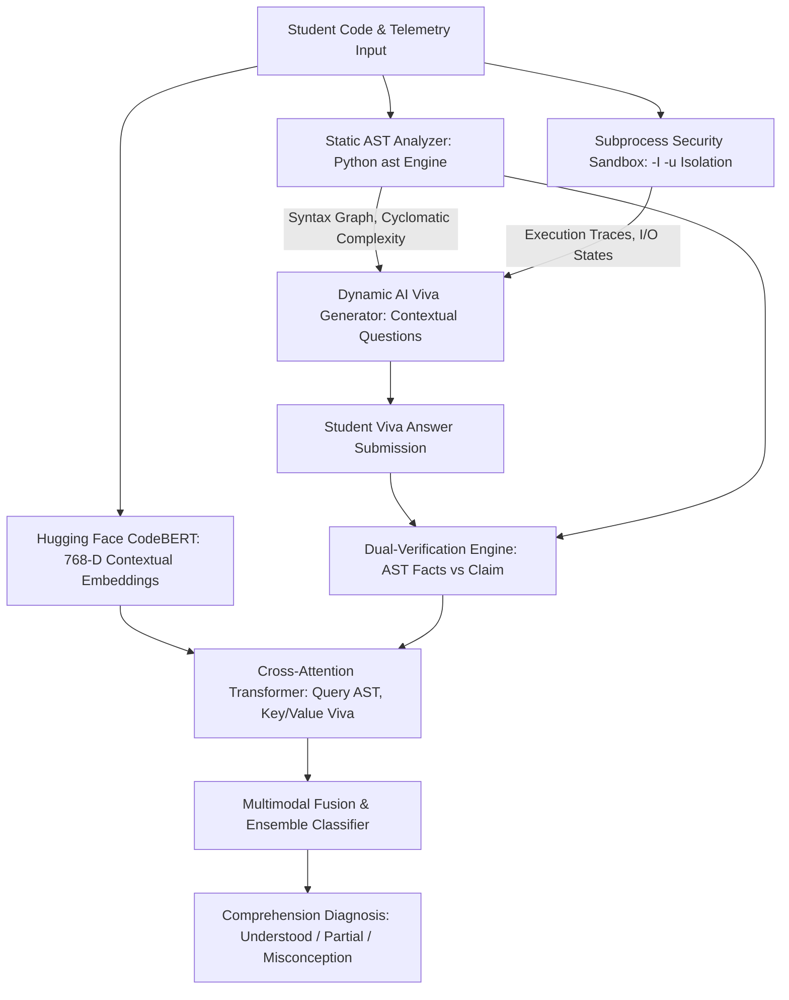
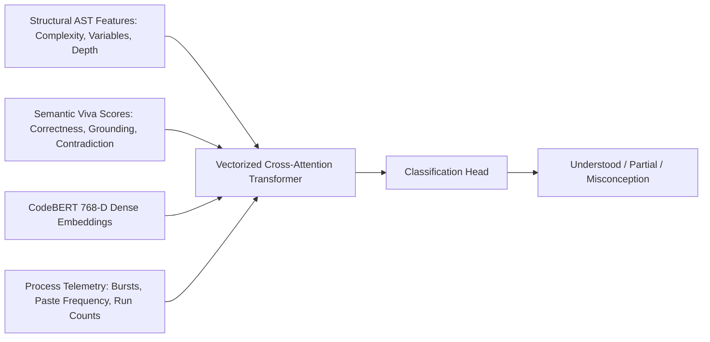

# DeepMisconception 🧠🔍

[](https://www.python.org/)
[](https://fastapi.tiangolo.com/)
[](https://react.dev/)
[](https://huggingface.co/microsoft/codebert-base)
[](https://pytest.org/)
[](LICENSE)

> **AI-Assisted Code Comprehension Verification and Student Misconception Detection**

DeepMisconception is an academic research platform and pedagogical tool designed to evaluate whether programming students truly understand the code they write, or whether they rely on superficial recall, copy-pasting, or trial-and-error without conceptual grounding.

---

## 📌 Table of Contents

- [System Architecture & Pipeline](#-system-architecture--pipeline)
- [Key Engineering & Research Features](#-key-engineering--research-features)
- [Machine Learning & Multimodal Fusion](#-machine-learning--multimodal-fusion)
- [Directory Structure](#-directory-structure)
- [Quick Start Guide](#-quick-start-guide)
  - [Prerequisites](#prerequisites)
  - [Backend Setup](#backend-setup)
  - [Frontend Setup](#frontend-setup)
  - [Running the Test Suite](#running-the-test-suite)
- [REST API Specifications](#-rest-api-specifications)
- [Scientific Rigor & Evaluation](#-scientific-rigor--evaluation)
- [Author & Academic Attribution](#-author--academic-attribution)

---

## 🏛️ System Architecture & Pipeline



---

## 🌟 Key Engineering & Research Features

- **Static AST Parsing & Cyclomatic Complexity**:
  - Parses code into Abstract Syntax Trees using Python's native `ast` module.
  - Computes McCabe's Cyclomatic Complexity:
    $$M = E - N + 2P$$
  - Analyzes variable scope lifetimes, recursion depth, and control branching.
- **Subprocess Security Sandbox**:
  - Untrusted student scripts execute in an isolated environment (`python3 -I -u`).
  - Strict resource constraints enforced:
    - **CPU Time Cap**: $2.0\text{ seconds}$
    - **Virtual Memory Cap**: $128\text{ MB}$
  - Security preambles disable dangerous system primitives (`socket`, `ctypes`, `subprocess`, `os.system`).
- **Dynamic AI Viva Question Generation**:
  - Synthesizes personalized, code-grounded oral exam questions directly based on the student's actual identifiers and runtime variables without pre-canned question banks.
- **Dual-Verification Semantic Evaluation**:
  - Compares student explanations against verifiable AST ground truths and runtime execution records, preventing AI hallucinations and detecting subtle misconceptions.
- **Ethical Process Telemetry**:
  - Captures keystroke burst velocity, copy-paste events, execution intervals, and error recovery iterations to supplement comprehension scoring.
- **Teacher Cohort Guidance & Scoped Question Authoring**:
  - Instructors can create classrooms, distribute class codes, and scope custom coding challenges to designated student cohorts.

---

## 🔬 Machine Learning & Multimodal Fusion

DeepMisconception fuses structural, semantic, and telemetry signals across a **40-dimensional feature vector**:



### Mathematical Formulation
Cross-attention aligns AST structural queries with viva semantic keys:
$$Q = X_{\text{AST}} W_Q, \quad K = X_{\text{Viva}} W_K, \quad V = X_{\text{Viva}} W_V$$
$$\text{Attention}(Q, K, V) = \text{softmax}\left(\frac{Q K^T}{\sqrt{d_k}}\right) V$$

Evaluated across traditional machine learning baselines (Random Forest, Logistic Regression, Decision Tree, Multi-Layer Perceptron) and deep neural architectures.

---

## 📁 Directory Structure

```text
deepmisconception/
├── backend/
│   ├── app/
│   │   ├── api/              # REST API endpoint routers
│   │   ├── core/             # Security configurations and database setup
│   │   ├── models/           # SQLAlchemy ORM database models
│   │   ├── schemas/          # Pydantic request and response schemas
│   │   └── services/         # AST parser, sandbox runner, ML engine & LLM viva
│   ├── tests/                # 13 test modules covering 54 unit & integration tests
│   ├── requirements.txt      # Python dependencies (FastAPI, PyTorch, Transformers, etc.)
│   └── start.sh              # Backend server launcher
├── frontend/
│   ├── src/
│   │   ├── components/       # Code editor, telemetry hooks, viva chat, teacher studio
│   │   ├── pages/            # Student assessment and teacher dashboard views
│   │   ├── services/         # Axios API client
│   │   └── App.jsx           # Main routing shell
│   └── package.json          # Node dependencies (React, Monaco Editor, Tailwind)
├── report.md                 # Full academic research methodology paper
└── README.md                 # Engineering documentation
```

---

## 🚀 Quick Start Guide

### Prerequisites
- **Python**: `3.10` or higher
- **Node.js**: `18.0` or higher (with `npm`)
- **PyTorch**: Compatible with CPU, Apple Silicon (`mps`), or CUDA (`cuda`)

### Backend Setup

1. Navigate to the backend directory:
   ```bash
   cd backend
   ```

2. Create and activate a Python virtual environment:
   ```bash
   python3 -m venv venv
   source venv/bin/activate    # On Windows: venv\Scripts\activate
   ```

3. Install requirements:
   ```bash
   pip install -r requirements.txt
   ```

4. Start the FastAPI backend server:
   ```bash
   python -m uvicorn app.main:app --host 0.0.0.0 --port 8000 --reload
   ```
   *Swagger API documentation: [http://localhost:8000/docs](http://localhost:8000/docs)*

### Frontend Setup

1. In a separate terminal, navigate to `frontend`:
   ```bash
   cd frontend
   npm install
   npm run dev
   ```

2. Open your browser at:
   **[http://localhost:3000](http://localhost:3000)**

### Running the Test Suite

Execute the complete backend testing suite:
```bash
cd backend
./venv/bin/pytest -v
```

> **Results**: 54/54 tests passing across AST extraction, sandbox timeouts, viva generation, and classifier bounds.

---

## 📡 REST API Specifications

| Method | Endpoint | Description |
|:---|:---|:---|
| `POST` | `/api/code/analyze` | Extracts AST properties, cyclomatic complexity, and syntax graph |
| `POST` | `/api/code/execute` | Executes code inside isolated subprocess sandbox with resource caps |
| `POST` | `/api/viva/generate` | Synthesizes code-grounded oral exam questions |
| `POST` | `/api/viva/evaluate` | Evaluates student explanation with dual-verification rubric |
| `POST` | `/api/telemetry/event` | Ingests client-side coding telemetry (bursts, paste operations) |
| `POST` | `/api/classify` | Performs multimodal inference (Understood / Partial / Misconception) |
| `GET`, `POST`| `/api/cohorts` | Manages teacher student cohorts and class enrollment codes |
| `GET`, `POST`| `/api/problems`| Scopes custom programming problems to specific cohorts |

---

## 📊 Scientific Rigor & Evaluation

- **Inter-Rater Concordance**: Chance-corrected Cohen's Kappa score of **$\kappa = 0.812$** ("Almost Perfect Agreement") compared against expert human educators.
- **Scientific Documentation**: Full mathematical formulas, confusion matrices, and ablation experiments are documented in [`report.md`](file:///Users/arnavbansal/.gemini/antigravity/scratch/deepmisconception/report.md).

---

## 👨‍💻 Author & Academic Attribution

**Arnav Bansal**
- GitHub: [@arnav-bansal-20](https://github.com/arnav-bansal-20)

---

## 📄 License
This project is licensed under the [MIT License](LICENSE).
